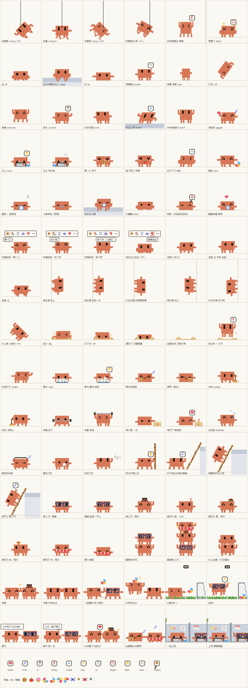
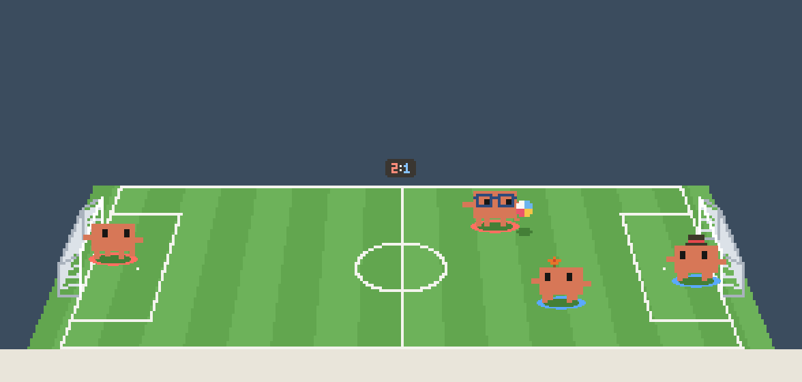

# Clawd 桌宠

一只住在 Windows 桌面上的像素 Clawd：会走、会坐、会爬墙、会挖沙把自己埋起来、会架根木杆爬到别的窗口上，能喂零食、扔球陪它玩，还能和 Claude Code 联动——Claude 在干活它就敲键盘，干完了它跳起来告诉你。

另外还有一个 **Chrome 扩展版**，Clawd 住在网页里，Chromebook 也能用，见 [ClawdPet-chrome](ClawdPet-chrome/README.md)。



## 安装（Windows 10 / 11）

不用装任何东西，用 Windows 自带的 .NET Framework 编译器就能编出来。

1. 点这个页面上的 **Code → Download ZIP**，解压到一个以后不会删的地方。
2. 在解压出来的文件夹里打开 PowerShell，运行：

   ```powershell
   powershell -ExecutionPolicy Bypass -File build.ps1
   ```

3. 双击编出来的 `ClawdPet.exe`。它没有任务栏图标，看屏幕底部，或者右下角托盘里的小橙块。

### Windows 拦着不让运行？

`ClawdPet.exe` 没有数字签名，所以：

- 弹出「Windows 已保护你的电脑」：点「更多信息 → 仍要运行」。
- 开了 **智能应用控制**（Smart App Control）的电脑，可能会直接拦住，提示「应用程序控制策略已阻止此文件」。每次重新编译出来的文件会被单独判断，有时能运行有时不能。这个没法从程序这边绕开，只能由电脑的主人自己决定要不要关掉智能应用控制。

## 怎么玩

| 操作 | 反应 |
|---|---|
| 右键 | 头顶冒出一排快捷按钮：喂一口、扔个球、睡一会儿、做个梦、待在这儿别动、更多（鼠标停在按钮上，上方会冒出文字提示；小人调到最小时按钮也不跟着缩） |
| 再右键一下 | 完整菜单 |
| 单击 | 蹲下蓄力再弹起来 |
| 双击 | 跳舞 |
| 连续戳 6 下 | 被戳晕 |
| 在它身上来回蹭鼠标 | 摸摸，晃一晃、脸红（只是划过去不算） |
| 按住拖动 / 甩出去 | 像钟摆一样挂在鼠标上晃，松手有重力和弹跳，摔狠了会晕，扔到屏幕边上会扒住墙 |
| 丢到别的窗口顶上 | 在窗口标题栏上走，拖窗口它会跟着晃 |
| 把文件拖到它身上 | 嚼一嚼，**文件路径复制到剪贴板**（可以直接粘贴给 Claude）；拖文字会告诉你字数行数 |
| 鼠标从它身边飞快划过 | 吓一跳 |
| 离开电脑 3 分钟（白天） | 慢吞吞走到屏幕右下角，打个哈欠躺下，盖上小被子睡；好几只时一只挨一只排着睡。你一动它就醒，伸懒腰把被子掀下去 |
| 到了晚上 | 默认晚上 11 点，大家都去右下角盖被子睡，夜里你动鼠标、打字都不会吵醒它们；早上 7 点各自隔几秒陆续起床。半夜点它、拎它或者菜单里「叫醒它」能把它叫起来陪你，5 分钟没人理就回去接着睡。夜里 Claude Code 干活也不叫醒它们（不摆工位）：干完了第一只在梦里笑一下，Claude 等你批准时它说梦话把提醒冒出来。几点睡、几点起在右键菜单「设置」里选，也可以关掉 |
| 托盘图标双击 | 把它叫到鼠标这里 |

### 它自己会做的事

- 走路、坐下、趴着、东张西望、托腮想事情、挠头、伸懒腰、转圈、打滚、做操、打喷嚏
- 对着小电脑办公、看书（会翻页偷笑）、弹尤克里里（坐在任务栏或标题栏边上，两条腿垂下来跟着拍子晃）、戴耳机听歌、吐泡泡、扫地、举重、堆沙堡、叠纸飞机扔出去（纸飞机会飞过屏幕）
- 跳到别的窗口标题栏上，坐在边上晃腿
- 扒着屏幕左右两边往上爬，爬到顶再松手或蹬墙跳回来
- 像螃蟹一样在任务栏上挖沙把自己埋起来，只露眼睛，被吓到就整个缩进去
- 走到某个窗口旁边，把一根长木杆竖起来，再往窗口那边一倒，像梯子一样斜靠在窗口的上角，然后斜着身子顺着杆子一段一段爬上去，跳到标题栏上，杆子收走（窗口两边都没地方斜靠时，就竖着立在窗口底下爬）
- 「扔个球」之后会追着球踢、用头顶；球也能用鼠标拿起来扔
- 打盹、冒鼻涕泡、做梦（自己随便打的小盹就在原地睡；你让它睡、或者你离开了，它会去右下角盖被子睡）

### 好几只 Clawd

右键菜单里点「再叫一只 Clawd」，最多 4 只。第二只戴眼镜，第三只戴帽子，第四只的饰品跟着季节换（春天别小花、夏天顶西瓜、秋天顶枫叶、冬天围围巾），好分辨；下次打开还是这么多只。它们会：

- **叠高高**：走到伙伴旁边跳到它头上，最多叠 4 层；下面那只举手托着、抬头看，偶尔驮着慢慢走，托久了会被压得晃起来把上面的抖下去
- 见面挥手打招呼、走过去击掌
- **一起踢球**：扔个球出来，大家都跑过去，你一脚我一脚地传。会贴地传、吊高球、用头顶回去，球在身后就挑过头顶。谁离球近谁去踢，传给谁谁去接，不抢球。传完一轮，接到最后一脚的停住球，再跑去跟伙伴击掌。它们闲着时偶尔也会自己拿个球出来叫伙伴一起踢
- **踢比赛**：四只都在的时候，它们偶尔会在屏幕下方铺开一块小足球场，像电视转播那样斜着看：草坪越远越窄，有顺着透视的剪草条纹、中圈、两个禁区，两头立着带网的球门，远处挂一块比分牌（红队的分是红字、蓝队的是蓝字）。球场点得穿，不挡你点下面的窗口。2 对 2 开踢，每只脚下一圈红色或蓝色，分得清谁跟谁一队；它们在场上前后左右跑位，近的盖住远的。每队一只当前锋、一只当守门员。前锋绕到球后面往前带，前面被挡住了就斜着绕过去、把球往边线踢撞墙反弹再自己追上去、回传给守门员，或者干脆远射；离门近了就射门，高球落下来跳起来头球。守门员在门线上跟着球横着挪，射门飞过来就飞身去扑：扑住了有时抱在怀里，等前锋拉开到没人的那边再传过去，有时托出去，对面前锋还能补射；球进了禁区就冲出去处理，被逼急了就大脚开远。射门扑不扑得住看远近和角度（越贴门柱越难扑），偶尔射偏擦柱而出或者打在门柱上弹回来。球会滚、会飞、落地弹几下，下面有影子；四周像室内足球场一样有挡板，碰到边线弹回来。进球的那队蹦着庆祝，比分牌加一分，再回中圈开球。先进 5 个球或者踢满两分半钟就吹终场，赢的蹦、输的也冒心心，大家走回球场最前面的边线，场地收起来，两队互相击掌。只有两三只时，也可以在右键菜单「一起玩」里点「比赛」叫它们踢；踢的时候再点一次「结束比赛」就不踢了
- **一起上班**：四只都在、Claude Code 开始干活时，任务栏上摆开一排小隔间（隔板、便利贴、日程表、挂钟、两头各一盆绿植），每只坐进一个，对着小电脑噼里啪啦敲，偶尔歪头看看隔壁、伸个懒腰；第一只头上照常转圈显示 Claude 的进度。Claude 干完了大家一起蹦一下，工位收起来。比赛踢到一半 Claude 来活了，比赛先散场
- **聊天**：时不时走到伙伴跟前聊几句，头上冒文字气泡。会夸对方戴的眼镜、帽子，看时间说早安、聊午饭、盼下班。聊完一起笑、一起转过来看着你，或者约着去叠高高、踢球、跳舞、击掌。不想看到字的话，把右键菜单「设置」里的「它们聊天时冒字」关掉，就只比划表情
- **捧场**：一只开始弹琴、听歌、看书、举重、堆沙堡、吐泡泡，旁边闲着的伙伴会过来坐着看，跟着晃、喊加油，表演完鼓掌
- **一起睡**：右键菜单「一起玩」里点「一起睡」，大家都去屏幕右下角，离角落近的先躺，一只挨一只排好，每只盖一条自己颜色的小被子（蓝、粉、绿、黄），被子拉到下巴，鼻涕泡照冒。睡够了自己起来
- **安慰**：一只被戳晕或者摔晕，离得近的伙伴会跑过来拍拍它，它就缓过来了
- **分零食**：喂了一只，它有时会走过去分伙伴一口
- 一只跳舞，旁边闲着的跟着一起跳
- 一只被拎起来或掉下去，其他的一直盯着看
- Claude Code 干完活时一起蹦一下

右键菜单「一起玩」那一排有「叠高高」「击掌」「踢球」「聊天」「比赛」「一起睡」，想让哪只走就点它的「送走这只」。



### 音效

8-bit 风格的小声音，全在程序里现场合成，不带音频文件；右键菜单「设置」里的「音效」是总开关，勾上全开、去掉全关（默认开）；开着的时候下面多一排「音量」，可以选轻、中、响（默认中，点一下会「啵」一声让你听听有多响）。几个声音能叠在一起响，播完就关掉声卡输出，不会一直占着声卡，也不会拦着电脑睡眠。

- **你碰它**：戳一下「啵」（四只嗓音高低不一样）、双击跳舞一串小琶音、拎起来「咦！」、扔下来摔在地上「噗」、扔到墙上「啪叽」、戳晕了头上小鸟「啾啾啾」、点醒或者把埋在沙里的它吓出来「哇！」、叫出来一只「嘟噜噜」、送走往下三个音
- **正事**：Claude 干完活「叮叮叮叮」往上走、Claude 等你批准和久坐提醒「叮——咚」、番茄钟专注完成四声往上、休息结束两声、提醒到点像小闹钟「叮叮、叮叮」
- **它们自己玩**：弹尤克里里真的拨弦（五声音阶，怎么弹都好听）、聊天时叽里咕噜（像动物说话，一个字一下）、打哈欠、打喷嚏、鼻涕泡破了「啵」、跳到伙伴头上「嘣~」、击掌「啪」、踢球「嘭」、球落地弹「嘟」、纸飞机「咻~」、木杆靠上窗角「哒」；踢比赛时有开球哨、射门、扑救、打门柱「当~」、进球号角、终场三声哨
- **梦里的小游戏**：跳、踩弹簧、收集东西、踩扁 bug、被撞到、掉下去、过关和被吓醒都有声音（背景音乐还是用 M 开关）

什么时候不出声：全屏看视频、打游戏时只有你直接碰它、你自己定的番茄钟和提醒才响；夜里它们睡着时（没被你叫醒）同样只有这些响，Claude 的提醒也不响；专注番茄钟进行中、或者你三分钟没碰电脑时，它们自己玩出来的声音都不响。

### 梦境小游戏

它睡着做梦时，右键菜单里点「钻进它的梦里玩」（醒着时叫「做个梦（小游戏）」）：一关横版跑跳，收集它梦到的东西、踩扁 bug，跑到枕头那儿它就睡饱了。有 5 颗心，只有被 bug 撞到才扣；掉下去不扣心，会回到刚才站过的地方接着跑。玩的时候有背景音乐：一首自己写的 8-bit 小曲（F 大调，约 80 秒），有前奏、主题、带对位的主题、转到小调的抒情段、往上爬的过门、加和声的主题再现和尾声，配鼓和回声，程序现场合成，不用额外的音乐文件。← → 或 A D 走，空格 / ↑ 跳，M 开关音乐（会记住），Esc 醒来。

### 完整菜单

顶层只放常用的，其余收在两个子菜单里：

- **陪它玩**：喂一口、扔个球、跳舞、说句话、挖沙（埋着时变成「钻出来」）
- **一起玩**（好几只时才有）：叠高高、击掌、踢球、聊天、比赛、一起睡
- 睡一会儿（去右下角盖被子睡）/ 叫醒它、做个梦（小游戏）、待在这儿别动；Claude 在干活时多一项「别忙了」
- **番茄钟和提醒 ▸**：专注 25 / 50 分钟、休息 5 分钟（头旁边挂倒计时小牌子，到点庆祝并弹系统通知）；提醒我…（填几分钟后提醒什么，到点它跳出来喊你）。正在计时或者有提醒时，外面这一项会标出来
- **设置 ▸**：大小、跟着鼠标走、偶尔自言自语、它们聊天时冒字、健康提醒（默认开：连续用电脑 50 分钟提醒活动；笔记本没插电且电量 ≤ 20% 提醒充电；CPU 持续 > 90% 时它冒汗）、晚上自动睡觉（默认开，几点睡在 21:00–1:00 里选，几点起在 6:00–10:00 里选）、音效（总开关，默认开；开着时可选音量轻 / 中 / 响，默认中）、开机自动启动、叫到鼠标这儿来
- 再叫一只 Clawd / 送走这只、退出

全屏看视频、打游戏时它会自动躲起来。设置保存在 `%LOCALAPPDATA%\ClawdPet\settings.ini`；每只站在哪每 20 秒记一次（`positions.ini`），重新打开时就在原地冒出来，不用从屏幕上方重新掉下来。

## 和 Claude Code 联动（可选）

在 `~/.claude/settings.json`（Windows 上是 `C:\Users\你的用户名\.claude\settings.json`）里加上下面的 `hooks`。把 `C:/path/to/ClawdPet.exe` 换成你自己的 `ClawdPet.exe` 路径，斜杠用 `/`。如果文件里已经有 `"hooks"`，把这四项合并进去，别整段覆盖。

```json
{
  "hooks": {
    "UserPromptSubmit": [{ "hooks": [{ "type": "command", "command": "C:/path/to/ClawdPet.exe", "args": ["--signal", "thinking"], "async": true, "timeout": 10 }] }],
    "Stop":             [{ "hooks": [{ "type": "command", "command": "C:/path/to/ClawdPet.exe", "args": ["--signal", "done"],      "async": true, "timeout": 10 }] }],
    "Notification":     [{ "hooks": [{ "type": "command", "command": "C:/path/to/ClawdPet.exe", "args": ["--signal", "attention"], "async": true, "timeout": 10 }] }],
    "SessionEnd":       [{ "hooks": [{ "type": "command", "command": "C:/path/to/ClawdPet.exe", "args": ["--signal", "end"],       "async": true, "timeout": 10 }] }]
  }
}
```

| Hook | Clawd 的反应 |
|---|---|
| UserPromptSubmit | 敲键盘 + 转圈「Clauding… 1m 23s」（多个会话同时跑会显示 ×2）；四只都在时大家坐进一排小工位一起干活 |
| Stop | 跳起来：「项目名 搞定！（用时 2m 13s）」 |
| Notification | 举手蹦跶：「Claude 想用 Bash，等你批准~」 |
| SessionEnd | 把这个会话从统计里去掉 |

hook 的 JSON 从 stdin 读进来，用来拿会话 id、项目名（cwd 的文件夹名）和通知内容，不会往外发任何东西。如果 Claude 被中途打断没收到 Stop，右键菜单里点「别忙了」可以清掉状态（20 分钟没动静也会自动清）。

信号是一个个小文件，放在 `%USERPROFILE%\.clawdpet\signals`。不放 `%LOCALAPPDATA%` 是因为 Claude 桌面版是打包应用：它启动的 hooks 往 AppData 里写的文件会被 Windows 转存到它自己的专用目录，从桌面打开的桌宠就收不到了。用户目录不会被转存，从命令行版、桌面版用都一样。

## 命令行

```
ClawdPet.exe                       启动（只允许一个实例，重复启动会把它叫出来）
ClawdPet.exe --signal <事件>       给正在运行的桌宠发信号
                                   Claude Code：thinking / done / attention / end
                                   其他：hello / ball / pole / read / guitar / music / bubbles / lift / sweep / castle / plane
                                   好几只：addpet（再叫一只）/ stack（叠高高）/ five（击掌）/ soccer（一起踢球）/ match（踢场比赛，在踢就结束）/ chat（聊几句）/ bed（都去右下角盖被子睡）/ dizzy（第一只晕一下，看伙伴来安慰）/ down（都跳下来）/ dismiss（送走最后叫出来的那只）
ClawdPet.exe --preview2 out.png    把所有动作画成一张预览图
ClawdPet.exe --pitch out.png       把半俯视小足球场（四只在场上踢）画成一张预览图
ClawdPet.exe --dream               只打开梦境小游戏
ClawdPet.exe --music out.wav       把梦境小游戏的背景音乐存成 WAV
ClawdPet.exe --sfx <目录>          把所有音效各存一个 WAV，再连成一个 all.wav 方便一次听完
ClawdPet.exe --icon out.ico        生成图标文件
```

## 改代码

全部代码在 `ClawdPet.cs` 一个文件里，只用 C# 5 和 .NET Framework 4 自带的 WinForms，改完运行 `build.ps1` 重新编译（编译前先右键桌宠 → 退出）。

性能排查：设环境变量 `CLAWD_PROFILE=1` 再启动，会每 10 秒往 `%LOCALAPPDATA%\ClawdPet\profile.log` 写一行帧耗时。

行为排查：设环境变量 `CLAWD_DEBUG=1` 再启动，每只 Clawd 换状态、传球、聊天都会往 `%LOCALAPPDATA%\ClawdPet\debug.log` 记一行。再设 `CLAWD_NOAFK=1`，你不碰电脑时它们也不会去睡觉，方便测试（埋在沙里的那只还是会睡）。

## 协议

代码用 [MIT 协议](LICENSE)。Clawd 的名字和形象属于 Anthropic，不在这个协议里。
